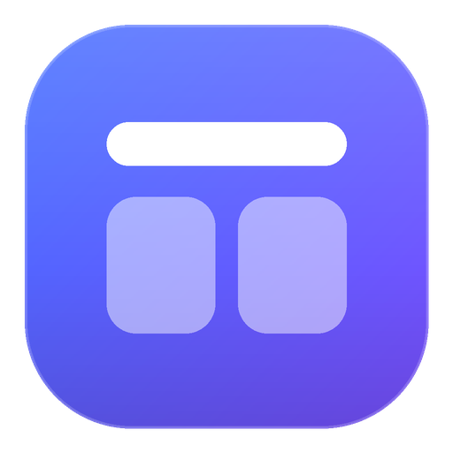
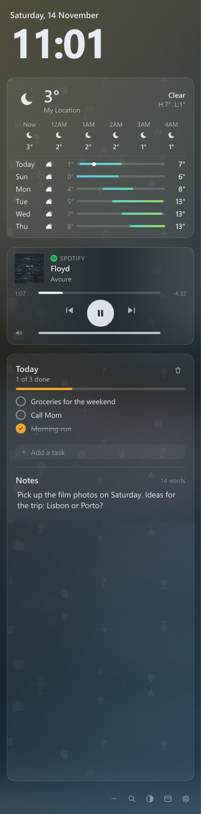
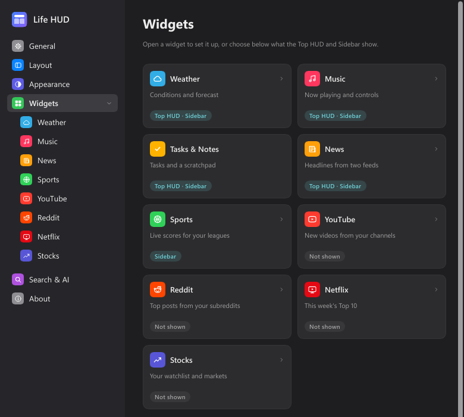

<div align="center">



# Life HUD

Your day at a glance, docked to the edge of your screen.<br>
A heads-up display for Windows, written in Rust.

[](https://www.rust-lang.org)
[](https://github.com/George-API/LifeHUD/releases/latest)
[](https://github.com/George-API/LifeHUD/actions/workflows/ci.yml)
[](LICENSE)

<a href="https://github.com/George-API/LifeHUD/releases/latest/download/lifehud.exe"></a>

<sub>Windows 10 or 11 · 18 MB · no admin needed</sub>

<br>
<br>



<br>
<br>

</div>

Clock, weather, music, tasks and more, in a slim bar across the top of your screen or a column down
the side. It reserves its space like the taskbar does, so windows resize around it instead of hiding
under it.

- **Native and light.** One 18 MB exe. No Electron, no runtime, ~0.5% of one core with music playing.
- **Private.** No account, no telemetry, no ads. Everything stays on your machine.
- **Yours.** Pick any four widgets and one of seventeen themes, most in light and dark.

## Install

1. **[Download `lifehud.exe`](https://github.com/George-API/LifeHUD/releases/latest/download/lifehud.exe)** (always the latest version).
2. Open it. If you see *"Windows protected your PC"*, click **More info → Run anyway**. The exe isn't
   code-signed yet; Windows only asks once.

That's it. It installs for your user, adds itself to the Start menu and *Settings → Apps*, docks to the
top of the screen and opens Settings. To update, download and open it again. For a portable copy, put
an empty file named `portable` next to the exe.

Requires Windows 10 (2004) or later. Releases are built by [CI](.github/workflows/release.yml) from this
repo and ship with a SHA-256.

## Widgets

| Widget | What it shows |
| --- | --- |
| Weather | Hourly and daily from [Open-Meteo](https://open-meteo.com), cached for offline |
| Music | Spotify or any app with Windows media controls: seek, volume, right-click for playlists |
| Tasks & Notes | A to-do list that rolls unfinished tasks over, plus a scratchpad |
| YouTube & Netflix | New uploads and the Top 10, played in the widget, plus what's playing in your browser |
| Reddit | r/popular and your subreddits |
| News, Sports, Stocks | Headlines, your teams' scores, a watchlist |
| Search | Google, or ask ChatGPT, Claude or Gemini with your own API key |

Long-press the HUD to rearrange widgets, or use *Settings → Widgets*. Themes are under the paintbrush.



## Privacy

- Data lives in `%LOCALAPPDATA%\LifeHUD`. Each widget talks only to its own source (Open-Meteo, the
  feeds in [`news.rs`](src/services/news.rs), ESPN, YouTube, Reddit, Netflix, Yahoo Finance). Sports,
  YouTube, Reddit, Netflix and Stocks only connect while they're on screen.
- Music and "now watching" come from Windows media controls. Browser window titles are checked in
  memory to tell YouTube from Netflix, never stored or logged.
- AI messages go only to the provider you picked, only when you hit send. Conversations aren't saved;
  keys live in Windows Credential Manager.

## Tips

- The tray icon opens Settings; its menu has show/hide, layout, search and widget editing.
- In edit mode, drag cards to reorder, drag one to the tray to remove it, or drop a widget onto a card
  to swap. Esc finishes, Ctrl+Z undoes.
- `lifehud.exe --exit` quits and gives the screen space back.
- A window that won't move aside belongs to an app running as admin; Windows doesn't allow it.
- Uninstall from *Settings → Apps*. Your data stays in `%LOCALAPPDATA%\LifeHUD` until you delete it.

## Building

Rust 1.92+ with the MSVC toolchain.

```
cargo run --release
```

Built on [Slint](https://slint.dev), with Win32 and WinRT called directly. Debug builds can render any
widget offscreen with `cargo run -- --snapshot <dir> <widget>`.

## Contributing

Each widget is a data source in `src/services/`, a controller in `src/feeds/` and a Slint file in
`ui/widgets/`. [CONTRIBUTING.md](CONTRIBUTING.md) walks through adding one. Widgets, themes and fixes
are all welcome.

For bugs, attach `%LOCALAPPDATA%\LifeHUD\lifehud.log`. Report security issues via
[SECURITY.md](SECURITY.md).

## License

MIT. The UI uses Slint under its royalty-free desktop license, which requires the "Made with Slint"
badge on the About page; keep it in your own builds.

Not affiliated with Spotify, YouTube, Reddit, Netflix, ESPN, Yahoo, OpenAI, Anthropic or Google.
